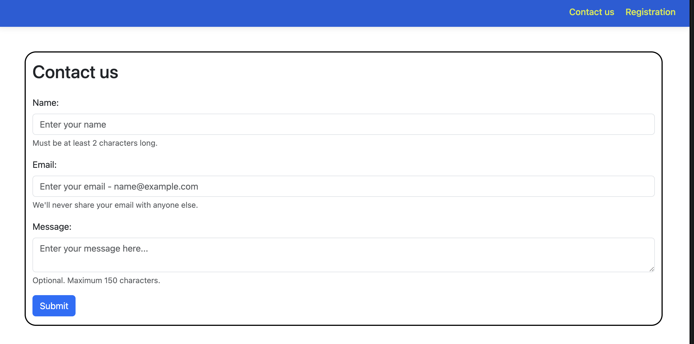
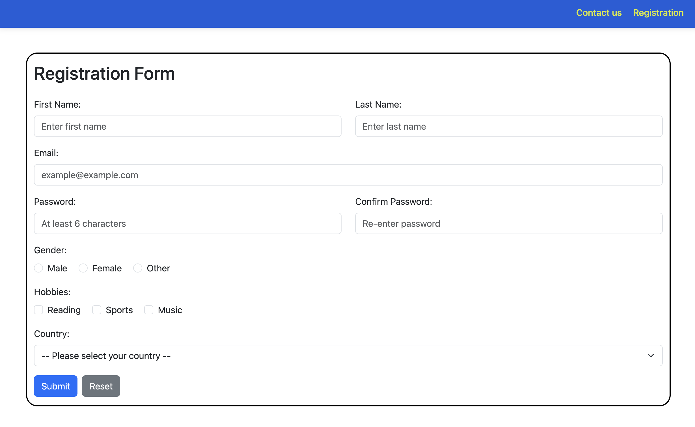

# Assignment #4

## Student Information
* **Name:**  SerikbaiDarkhan
* **Group:** SE-2540
---
#### Task 1. 
* **Description:** Created a basic contact form with Name, Email, and Message fields, incorporating proper HTML5 validation attributes (`required`, `minlength`, `maxlength`).
* **Screenshot:**

#### Task 2. Bootstrap Form Styling & Task 3. Bootstrap Validation Styles
* **Description:** Recreated and styled the contact form using Bootstrap form classes, grid structure, helper text, and validation feedback classes (`needs-validation`, `invalid-feedback`, `valid-feedback`).
* **Screenshot:**

---

### Part 3. Advanced Form Project
* **Screenshot:** 

#### Task 4. Registration Form
* **Description:** Made a responsive registration form featuring first/last names, email, password matching validation, gender radio buttons, hobby checkboxes, and a country selection dropdown styled with the Bootstrap Grid and custom validation scripts.
* **Screenshot:**

---

## Work Process Summary
I created the Contact Us and Registration pages using HTML, custom CSS, and Bootstrap 5 for a clean, responsive design. I added form validation using HTML5, Bootstrap styles, and a small JavaScript script to check if the passwords match. Finally, I tested all the fields to make sure they show error and success messages correctly.# web4
